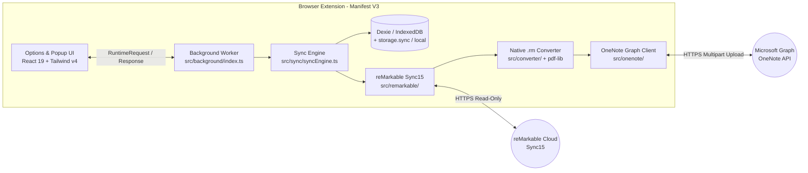

# Contributing & Developer Architecture Guide

First off, thank you for considering contributing to `rmOneNoteWebExtension`. Whether you are fixing a bug in a specific pipeline stage, adding a feature, or improving documentation, this guide walks through how every module operates and fits together.

---

## Table of Contents

- [Getting Started](#getting-started)
- [High-Level System Flow](#high-level-system-flow)
- [Architecture Deep Dives](#architecture-deep-dives)
  - [1. Background Worker, Messaging & Shared Primitives (`src/background/`, `src/shared/`)](#1-background-worker-messaging--shared-primitives)
  - [2. Authentication Layer (`src/auth/`)](#2-authentication-layer)
  - [3. IndexedDB & Cross-Browser Sync Storage (`src/db/`, `src/storage/`)](#3-indexeddb--cross-browser-sync-storage)
  - [4. reMarkable Sync15 Client & Tree Diffing (`src/remarkable/`)](#4-remarkable-sync15-client--tree-diffing)
  - [5. Native `.rm` Parser, InkML Converter & PDF Slicer (`src/converter/`)](#5-native-rm-parser-inkml-converter--pdf-slicer)
  - [6. Microsoft Graph OneNote Client (`src/onenote/`)](#6-microsoft-graph-onenote-client)
  - [7. Autonomous Sync Engine & Alarm Scheduler (`src/sync/`)](#7-autonomous-sync-engine--alarm-scheduler)
  - [8. Extension UI, Demo Mode & Onboarding Tour (`src/options/`, `src/popup/`)](#8-extension-ui-demo-mode--onboarding-tour)
- [Repository Structure](#repository-structure)
- [Development Setup & Azure App Configuration](#development-setup--azure-app-configuration)
- [Building, Testing & Packaging](#building-testing--packaging)
- [CI/CD Pipeline](#cicd-pipeline)
- [Submitting a Contribution](#submitting-a-contribution)

---

## Getting Started

### Pull Request Workflow

1. **Find or Open an Issue:** Check open Issues or file one using our [Issue Templates](.github/ISSUE_TEMPLATE/config.yml) so work is coordinated.
2. **Fork & Clone:** Fork the repository to your account and clone it locally.
3. **Branch:** Use semantic branch names such as `fix/pdf-page-guard` or `feat/abort-sync`.
4. **Conventions:** Follow TypeScript strict mode (`tsconfig.json`), keep modules simple (`KISS`), and always use `pnpm` / `pnpx`. **Never use emojis** in UI text, code comments, logs, or documentation; all icons are curated manually by the maintainer.
5. **Verify Before Opening a PR:** Run `pnpm run typecheck`, `pnpm test`, and `pnpm run build`.
6. **Open a Pull Request:** Target `main` and include `Fixes #<issue-number>` in your PR body.

---

## High-Level System Flow

Unlike the original C# desktop-and-daemon [rmOneNoteSync](https://github.com/Excustic/rmOneNoteSync) project, the extension runs **100% client-side inside browser Manifest V3 contexts**.



---

## Architecture Deep Dives

### 1. Background Worker, Messaging & Shared Primitives

**Directory:** `src/background/`, `src/shared/`

The background script compiles as an ephemeral Service Worker on Chromium and as an Event Page on Firefox (`src/manifest.ts`, `vite.config.ts`). Because the browser can terminate idle workers at any time, all top-level listeners must register synchronously on startup.

| File | Responsibility |
|---|---|
| `src/background/index.ts` | Single message router (`ext.runtime.onMessage`), compile-time exhaustive `VALID_REQUEST_TYPES_LIST` check against `RuntimeRequest['type']`, `executeManagedSyncCycle`, `ABORT_SYNC` handler, and stale-phase self-healing (`readSyncOverview()` resets active overview phases back to `Idle` if `isSyncCycleRunning()` is `false`, alongside `resetInProgressPages()` on `onInstalled` / `onStartup`). |
| `src/shared/messaging.ts` | Shared discriminated union types for `RuntimeRequest`, `RuntimeResponse`, `SyncPhase` (`Idle`, `Queued`, `Converting`, `Uploading`, `Indexing`, `Error`), and `SyncOverviewState`. |
| `src/shared/abort.ts` | Shared cancellation and network hang protection (`fetchWithAbortAndTimeout` with a 60s default request timeout + caller `AbortSignal` composition, `createAbortError`, `isAbortError`, `throwIfAborted`). |
| `src/shared/browser.ts` | Unified `ext` wrapper over `webextension-polyfill`, cross-browser origin permission helpers (`requestHostOriginsFromGesture`), and options-tab route navigation. |
| `src/shared/routes.ts` | Hash-route definitions (`dashboard`, `sync-control`, `settings`, `setup`) and URL hash parsing/formatting. |
| `src/manifest.ts` | Generates browser-specific MV3 `manifest.json` differences (Chromium `service_worker` vs Firefox `scripts`, `browser_specific_settings.gecko`, optional host permissions). |

---

### 2. Authentication Layer

**Directory:** `src/auth/`

All credentials stay strictly inside browser-local storage (`browser.storage.local` via `authStore.ts`) and are never replicated to `storage.sync`.

| File | Responsibility |
|---|---|
| `remarkableAuth.ts` | Exchanges a user-supplied 8-character OTP code at `my.remarkable.com` for a long-lived device token (`/token/json/2/device/new`), derives short-lived JWT user session tokens (`/token/json/2/user/new`), and exposes `fetchWithRemarkableAuth` (auto-injects Bearer token, aborts cleanly, refreshes & retries once on HTTP 401). |
| `microsoftAuth.ts` | Implements Microsoft Entra ID OAuth 2.0 Authorization Code + S256 PKCE via `browser.identity.launchWebAuthFlow`. Coalesces concurrent silent refreshes (`inflightMsRefresh`) 5 minutes before token expiry and provides `fetchWithMicrosoftAuth` with automatic HTTP 401 refresh-and-retry. Scopes: `openid`, `profile`, `offline_access`, `Notes.ReadWrite`, `Notes.Read`, `Notes.Create`. |
| `pkce.ts` | Web Crypto API (`crypto.getRandomValues`, `crypto.subtle.digest('SHA-256')`) PKCE verifier/challenge and Base64url encoding helpers. |
| `jwt.ts` | Lightweight payload decoder (without verification libraries) used to inspect token `exp` claims and extract Microsoft account `preferred_username` / `upn` / `email` display strings. |
| `authStore.ts` | Persists `rmAuth`, `msAuth`, and optional `msAuthConfig` in `storage.local`, and resolves the active Azure Client ID / Tenant ID (`storedClientId || BUILT_IN_AZURE_CLIENT_ID || VITE_AZURE_CLIENT_ID`). |

---

### 3. IndexedDB & Cross-Browser Sync Storage

**Directory:** `src/db/`, `src/storage/`

The extension separates heavy per-document state (stored locally in IndexedDB) from compact cross-device sync state (stored in `browser.storage.sync` unless Local-Only privacy mode is enabled).

| File | Responsibility |
|---|---|
| `src/db/db.ts` & `src/db/models.ts` | Defines `RmOneNoteDatabase` (`Dexie`) with three tables: `documents` (`documentId`), `pages` (composite primary key `[documentId+pageId]`), and `notebooks` (`oneNoteNotebookId`, unique `&displayName`). Tracks `PageSyncStatus` (`Pending`, `Queued`, `Converting`, `Uploading`, `Indexing`, `Uploaded`, `Failed`, `Skipped`, `Deleted`), `titleRenameOnly`, `originalPageNumber`, and `cloudVersion`. |
| `src/db/repository.ts` | Transactional CRUD helpers, `getPendingPages`, `resetInProgressPages` (recovers `Queued`/`Converting`/`Uploading`/`Indexing` rows to `Pending` after crash or abort), and document/page queries. |
| `src/db/backup.ts` | Exports/imports full IndexedDB `documents`, `pages`, and `notebooks` snapshots as portable `.json` backup files. |
| `src/storage/uuidCodec.ts` | Packs 36-char hyphenated UUIDs into 22-char Base64url strings and packs ledger entries (`docUuid[22] + pageUuid[22] + base64UnixSec[4]` = 48 chars/entry) to maximize `storage.sync` capacity. |
| `src/storage/preferences.ts` | Manages `UserPreferences` (`syncIntervalMinutes`, `targetSection`, `pageSyncStrategy`, `maxSectionPagesQueryLimit`, `syncUnannotatedPdfPages`, `syncConcurrency`, `containerWidthPx`, `autoSync`, `autoAddNewFiles`), chunked whitelists (`syncFiles` + `syncFolders`), `localStorageOnly` mode toggling/data migration/cloud wipe, and `cloudStorageUpdatedAt`. |
| `src/storage/syncLedger.ts` | Maintains up to 8 chunks x 160 = **1,280 synced page entries** across devices in `storage.sync` (or `storage.local` when `localStorageOnly` is enabled). Automatically tracks evicted entries (`evictedCount`) so a newly installed browser knows when to prompt the user for a local `.json` backup import. |

---

### 4. reMarkable Sync15 Client & Tree Diffing

**Directory:** `src/remarkable/`

Implements read-only access to reMarkable's content-addressed Sync15 API directly in memory.

| File | Responsibility |
|---|---|
| `sync15Client.ts` | Fetches `/sync/v4/root` generation/hash pointer and downloads UTF-8 schemas (`.docSchema`, `.metadata`, `.content`, `.pagedata`) or raw `.rm` / `.pdf` bytes via `/sync/v3/files/<hash>` with the mandatory `rm-filename` header. |
| `indexParser.ts` | Parses Sync15 `.docSchema` schema v3 and v4 index payloads (`ddvk/rmapi/api/sync15/tree.go` format) into structured `Sync15IndexEntry` lists. |
| `metadataParser.ts` | Walks folder `parent` pointers (with cycle guards) to build `virtualPath` strings (e.g., `University/Mathematics/Calculus 1`), parses `.metadata` and `.content` JSON (`cPages.pages` ordered lists vs legacy `pages` arrays, PDF source page index resolution, deletion exclusion via `deleted` / `parent === 'trash'`). |
| `treeSync.ts` | Compares cloud `root.docSchema` generation/hash against `cloudRootState`, only re-fetching documents whose top-level `.docSchema` hash changed, and reconciles Dexie `documents`/`pages` against active whitelists. Detects modified pages, reordered page numbers (`originalPageNumber`, `titleRenameOnly`), tablet-deleted pages, and enforces `canAutoSyncPage` / `resolveReconciledPageStatus` so unannotated blank PDF pages (`fileSizeBytes === 0`) stay `Skipped` unless enabled. |
| `treeSelection.ts` | Pure UI helper functions building nested `FileTreeNode[]` hierarchies, tri-state folder checkbox rollup (`checked`, `indeterminate`, `unchecked`), and subtree selection summaries. |

---

### 5. Native `.rm` Parser, InkML Converter & PDF Slicer

**Directory:** `src/converter/`

Converts reMarkable binary stroke/text streams into Microsoft Graph OneNote InkML and HTML payloads without any native binaries or WebAssembly.

| File | Responsibility |
|---|---|
| `binaryReader.ts` | `RmDataStream` and `TaggedBlockReader` decoding little-endian primitives, varints, CRDT IDs, sub-blocks, and `TagType` markers for `.rm` v6. |
| `crdtSequence.ts` | Ordered `CrdtSequence` container and deterministic Kahn topological sort (`toposortItems`) ported from `ricklupton/rmscene` (`crdt_sequence.py`). |
| `rmParser.ts` & `sceneItems.ts` | Parses `.rm` v6 tagged blocks (`SceneTree`, strokes, Type Folio `RootTextBlock`, glyph highlights, author/color registers) with per-block error containment, plus legacy `.rm` v3/v5 stroke files. |
| `textLayout.ts` & `writingTools.ts` | Computes CRDT character anchors, paragraph heights, stroke bounding boxes, pen width/pressure scaling, and OneNote-compatible brush RGBA definitions (ported from `ricklupton/rmc`). |
| `inkmlExporter.ts` | Stateless `convertRmPage()` pipeline transforming parsed strokes + text + optional extracted PDF background metrics into `{ inkmlXml, presentationHtml, hasContent }`. Uses per-invocation state so concurrent sync workers never collide. |
| `pdfExtractor.ts` | Wraps `pdf-lib` (`loadSourcePdfDocument`, `extractSinglePdfPageWithMetricsFromDocument`) to slice only the target 1-page PDF for annotated pages when rendering `` or attachment previews in OneNote. |

---

### 6. Microsoft Graph OneNote Client

**Directory:** `src/onenote/`

Executes rate-limit-safe OneNote API operations against `https://graph.microsoft.com/v1.0/me/onenote`.

| File | Responsibility |
|---|---|
| `oneNoteClient.ts` | REST client for notebooks, sections, paginated page listing (`listPages` with `$top=100`, `maxSectionPagesQueryLimit`, and `seenUrls` `@odata.nextLink` cycle guard), `uploadInkMlPage` (`POST`), `updateInkMlPage` (`PATCH`), `renamePage` (JSON `PATCH` title replace), `deletePage`, and `getPageWithPhantomLinkVerification`. Propagates `AbortSignal` and short-circuits retries immediately on `AbortError`. |
| `multipart.ts` | Builds RFC 7578 binary `multipart/form-data` request bodies combining `presentation` HTML, `presentation-onenote-inkml` XML, and optional PDF background parts. |
| `throttle.ts` | `AsyncSemaphore` (bounded concurrent Graph requests), `KeyedMutex` (prevents duplicate notebook/section race conditions across workers), `computeGraphBackoffMs` (`Retry-After` header parsing + jittered backoff for HTTP `429`/`500`/`503`/`504`), and abortable `defaultSleepMs`. |
| `directoryCache.ts` | Maps sanitized reMarkable `virtualPath` folders/documents to OneNote Notebook IDs and Section IDs, backed by `Dexie.notebooks` and Graph pre-warming (`primeFromGraph`). |

---

### 7. Autonomous Sync Engine & Alarm Scheduler

**Directory:** `src/sync/`

Orchestrates end-to-end sync runs from trigger to completion.

| File | Responsibility |
|---|---|
| `syncEngine.ts` | Enforces single active cycle execution (`activeDefaultSyncCycle`) with `abortActiveSyncCycle()`, runs ledger reconciliation -> `syncRemarkableCloudTree` -> `primeFromGraph` -> deleted-page purging (`mirror` mode) -> worker pool (`1..5` workers). Uses per-page creation mutex gates (`pageCreationGates`) so concurrent uploads within a single OneNote section still create pages in ascending numerical order. Handles `queueManualSyncItems` (document/folder vs explicit page overrides), `retryFailedPages`, `cancelSyncItem`, and `recoverDeletedPage` (with CAS expiration checks and `<Section> (Recovered)` placement). |
| `alarmScheduler.ts` | Binds `browser.alarms` (`AUTO_SYNC_ALARM_NAME`) to `UserPreferences.syncIntervalMinutes` and `autoSync`, firing background sync cycles when configured. |

---

### 8. Extension UI, Demo Mode & Onboarding Tour

**Directory:** `src/options/`, `src/popup/`

| Module | Responsibility |
|---|---|
| `OptionsApp.tsx` & `DataSourceContext.tsx` | Hosts hash-routed options views, resizable container divider (`MIN_CONTAINER_WIDTH_PX`–`MAX_CONTAINER_WIDTH_PX`), and seamlessly swaps between live runtime messaging and isolated `demoDataSource` during onboarding tours. |
| `Sidebar.tsx` | Responsive navigation rail (`min-w-[200px] max-w-[300px]`, fluid `clamp(200px,20vw,300px)`), route indicators, and `Take Interactive Tour` entry point. |
| `views/DashboardView.tsx` | Displays Pipeline State, Account Pairing, Synced & Indexed Pages, Profile Storage (`Local Only` vs `Cloud Synced`), missing-connection banners, `Sync Now` / `Abort Sync`, and the 30-day activity table with resizable columns. |
| `views/SyncControlView.tsx` | Renders the tri-state folder/document tree, search filter, `Engine` progress pill, `Abort Sync`, OneNote/reMarkable pairing banners, and the slide-in Pages Side Panel (per-page status badges, `Out of date` / `Moved` / `Reorder Pending`, collapsible `Deleted Pages` recovery). |
| `views/SettingsView.tsx` | Configures schedule, `Root notebooks Conversion` container (`Documents` default or blank), `maxSectionPagesQueryLimit`, `pageSyncStrategy` (`mirror` / `preserve`), `syncConcurrency`, blank PDF page toggle, Local-Only privacy opt-out, and `.json` DB backup export/import. |
| `views/SetupView.tsx` | Guides reMarkable Cloud OTP pairing and Microsoft OneNote sign-in. Displays Maintainer Redirect URI copy helper when `BUILT_IN_AZURE_CLIENT_ID` is not set. |
| `tour/` & `demo/` | `tourSteps.ts` + `TourOverlay.tsx` spotlight-driven onboarding tour, backed by an isolated `rmOneNoteDemoDb` IndexedDB instance (`demoData.ts`, `demoDataSource.ts`). |
| `src/popup/` | Lightweight toolbar popup (`PopupApp.tsx`, `QuickStatusView.tsx`, `UnconfiguredView.tsx`) showing live engine status, `Sync Now` / `Abort Sync`, and quick navigation into full-tab views. |

---

## Repository Structure

```text
rmOneNoteWebExtension/
├── .github/
│   ├── ISSUE_TEMPLATE/         # GitHub bug, feature & compatibility forms
│   └── workflows/ci.yml        # CI typecheck, Vitest, build & release workflow
├── public/
│   ├── icons/                  # Extension icons and provider logos
│   └── images/                 # README screenshots & store banners
├── scripts/
│   └── package.mjs             # Builds Chromium/Firefox/Edge/Opera packages + SHA256SUMS.txt
├── src/
│   ├── __tests__/              # Vitest test suites (fake-indexeddb & mocked browser APIs)
│   ├── auth/                   # reMarkable OTP + Microsoft Entra ID PKCE OAuth
│   ├── background/             # MV3 background service worker / event page
│   ├── converter/              # Pure TS .rm parser, InkML exporter & pdf-lib slicer
│   ├── db/                     # Dexie IndexedDB schema, repositories & backup export/import
│   ├── onenote/                # Microsoft Graph OneNote REST client, mutexes & throttling
│   ├── options/                # Full-tab React UI, Demo Mode & Interactive Tour
│   ├── popup/                  # Compact browser toolbar popup
│   ├── remarkable/             # Sync15 protocol client & delta reconciliation
│   ├── shared/                 # Runtime messaging types, abort/timeout helpers, browser polyfill
│   ├── storage/                # Preferences, Base64url UUID packing & cross-PC sync ledger
│   └── sync/                   # Autonomous background alarm scheduler & sync engine
├── CHANGELOG.md
├── CONTRIBUTING.md
├── PRIVACY.md
├── manifest.config.ts          # Shared Chromium/Firefox MV3 manifest builder
└── package.json
```

---

## Development Setup & Azure App Configuration

### Prerequisites

- Node.js 22+
- `pnpm` 10+

### Install & Launch Local Dev Profiles

```bash
pnpm install

# Launch Chromium with a persistent test profile (.dev-profile/chromium)
pnpm run dev

# Launch Firefox with a persistent test profile (.dev-profile/firefox)
pnpm run dev:firefox
```

### Microsoft OAuth in Local Unpacked Builds

In production releases, `BUILT_IN_AZURE_CLIENT_ID` in `src/auth/authStore.ts` allows end users to sign in with one click (and there is intentionally no Client ID field in the Setup UI).

However, Microsoft Entra ID locks each OAuth Client ID to specific extension Redirect URIs (`ext.identity.getRedirectURL()`, which depends on the unpacked extension ID or Firefox temporary add-on ID). If Microsoft sign-in rejects your local unpacked build's Redirect URI:

1. Create your own free App Registration in the **Microsoft Entra admin center** (Personal Microsoft accounts + work/school accounts, Public client / native / SPA platform).
2. Read the Redirect URI displayed in the Account Setup console/UI (or clear `BUILT_IN_AZURE_CLIENT_ID = ''` in `src/auth/authStore.ts` locally so `SetupView` renders the **Copy URI** helper box) and add that exact URI to your Azure App Registration's Redirect URIs.
3. Either paste your temporary Client ID into `BUILT_IN_AZURE_CLIENT_ID` locally (do not commit personal test IDs), **or** leave `BUILT_IN_AZURE_CLIENT_ID` empty locally and set `.env`:
   ```env
   VITE_AZURE_CLIENT_ID=your-azure-app-client-id
   VITE_AZURE_TENANT_ID=common
   ```
   > Note: In `src/auth/authStore.ts`, `BUILT_IN_AZURE_CLIENT_ID` takes precedence over `VITE_AZURE_CLIENT_ID` unless cleared or overridden in `storage.local` (`msAuthConfig`).
4. For UI-only changes that do not need live cloud APIs, launch **Take Interactive Tour** (Demo Mode) directly inside the extension to test Dashboard, Sync Control, and Settings with zero credentials.

---

## Building, Testing & Packaging

```bash
# Strict TypeScript check across app & tests
pnpm run typecheck

# Run full Vitest suite (uses fake-indexeddb and mocked WebExtension APIs)
pnpm test

# Build unpacked production bundles (dist/chromium and dist/firefox)
pnpm run build

# Build and generate distribution packages + SHA256SUMS.txt in artifacts/
pnpm run package
```

### Loading Unpacked Production Builds Manually

- **Chrome / Edge / Opera:** Open `chrome://extensions` (or `edge://extensions`), enable **Developer mode**, click **Load unpacked**, and select `dist/chromium`.
- **Firefox:** Open `about:debugging#/runtime/this-firefox`, click **Load Temporary Add-on...**, and select `dist/firefox/manifest.json`.

---

## CI/CD Pipeline

GitHub Actions (`.github/workflows/ci.yml`) runs three coordinated jobs:

| Job | Trigger | What It Does |
|---|---|---|
| `test` | Push / PR to `main` | Runs `pnpm install --frozen-lockfile`, `pnpm run typecheck`, and `pnpm test`. |
| `build-and-package` | After `test` passes | Runs `pnpm run package`, verifies all `.zip` and `.xpi` archives with `python3 -m zipfile -t`, outputs `artifacts/SHA256SUMS.txt`, and uploads build artifacts. |
| `release` | Tag pushes (`v*`) | Downloads validated archives and publishes a GitHub Release automatically. |

---

## Submitting a Contribution

1. Ensure `pnpm run typecheck`, `pnpm test`, and `pnpm run build` succeed cleanly.
2. Add or update unit tests in `src/__tests__/` for any bugfix or behavior change.
3. Update `CHANGELOG.md` under `## [Unreleased]` following Keep a Changelog format.
4. Keep functions focused and readable, explain *why* non-obvious logic exists, and describe **what** changed and **why** in your PR.
