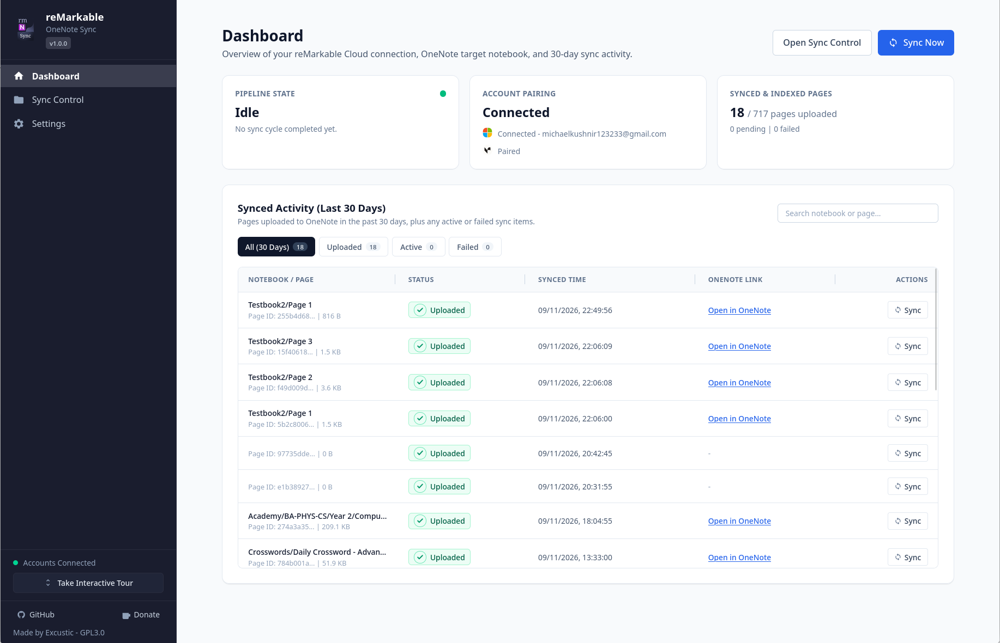
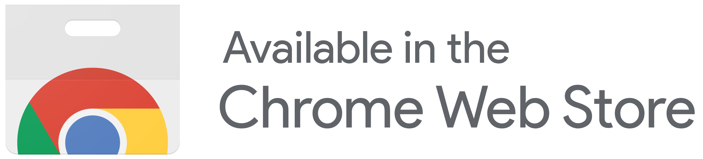

# reMarkable to OneNote Web Extension

A serverless Manifest V3 browser extension for autonomously synchronizing notebooks, handwritten ink, typed text, and PDF annotations from reMarkable Cloud directly into Microsoft OneNote.

  
   

## Why This Extension?

Originally built as a browser-native successor to the desktop [rmOneNoteSync](https://github.com/Excustic/rmOneNoteSync) application, this extension removes the need for SSH access, tablet-side daemons, OS background services, or Python/WebAssembly runtimes. 

The rmOneNoteSync project was built with the purpose of alleviating reMarkable tablet users of doing constant manual work of exporting documents to their cloud platforms.

With rmOneNoteSync, it is very straightforward
1. Pair your reMarkable & Microsoft accounts.
2. Choose Folders and Documents for automatic tracking and syncing.
3. Synchronize manually pages of documents as a one-time upload.
4. Optimize settings to your needs - sync intervals, OneNote-reMarkable mirroring strategy and more.
5. Life is easy now.

## Key Features

- **Serverless Cross-Browser Support:** Runs natively on Chromium (`Chrome`, `Edge`, `Opera`) and `Firefox` using Manifest V3 without an external relay server.
- **Direct In-Memory `.rm` Conversion:** Converts both `.rm` v6 CRDT `SceneTree` streams (including Type Folio text and shader/highlighter colors) and legacy `.rm` v3/v5 files into searchable OneNote ink, with on-demand single-page PDF background slicing.
- **Flexible OneNote Mapping:**
  - Folders/subfolders map to OneNote notebooks (e.g., `rm_University_Mathematics`), notebooks map to sections, and pages map to native OneNote pages.
  - Root-level notebooks group under a configurable default container (`Documents` -> `rm_Documents`) or become individual notebooks when left blank in Settings.
- **Granular Sync Control & Lifecycle Rules:**
  - Tri-state folder/notebook selection with automatic discovery for new notebooks added inside selected folders.
  - Slide-in Document Pages Inspector with per-page sync/cancel actions, status badges (`Uploaded`, `Pending`, `Queued`, `Converting`, `Uploading`, `Indexing`, `Failed`, `Skipped`), `Out of date` indicators, page-reorder badges (`Moved: Page X -> Page Y`, `Reorder Pending`), and `0 KB (Blank / No strokes)` labels.
  - Configurable **Mirror** (syncs deletions and page renames) vs. **Preserve** (append-only OneNote history with collision suffixing) strategies.
  - Collapsible **Deleted Pages** recovery drawer to restore tablet-deleted pages into `<SectionName> (Recovered)` sections while cloud blobs remain retained.
  - Blank unannotated PDF page skip guard (disabled auto-upload by default) and immediate **Abort Sync** cancellation.
- **Privacy Controls & Portability:**
  - Optional cross-device settings and 1,280-page rolling sync history via browser profile sync storage (`Chrome Sync` / `Firefox Sync`), or one-click **Local-Only storage mode** opt-out with Profile Storage monitoring on the Dashboard.
  - Full IndexedDB `.json` export/import for transferring complete sync history across machines. See [PRIVACY.md](PRIVACY.md).
- **Interactive Demo Mode & Tour:** Built-in guided walkthrough to test Sync Control, pipeline phases, tags, and privacy settings safely before connecting real accounts.

## Acknowledgements & Sources

This extension builds on generous open-source reverse-engineering work, protocol documentation, and libraries:

- **[ddvk/rmapi](https://github.com/ddvk/rmapi):** For documenting and pioneering the reMarkable Cloud Sync15 v3/v4 `.docSchema` index schema and HTTP API behavior (`api/sync15`).
- **[ricklupton/rmscene](https://github.com/ricklupton/rmscene):** For reverse-engineering and specifying the reMarkable `.rm` v6 tagged binary CRDT `SceneTree` format, LWW registers, and text/glyph blocks (`scene_stream.py`, `crdt_sequence.py`).
- **[ricklupton/rmc](https://github.com/ricklupton/rmc):** For the `.rm` to InkML conversion reference (`rmc/exporters/inmkl.py`), coordinate transforms, anchor positioning, and brush mappings ported to pure TypeScript in `src/converter/`.
- **[Excustic/rmOneNoteSync](https://github.com/Excustic/rmOneNoteSync):** Our predecessor C# desktop and tablet-daemon application, from which the Microsoft Graph OneNote multipart client, Phantom Link polling, directory mutex caching, and virtual-path mapping conventions originated.
- **Core Libraries:** [Dexie.js](https://dexie.org/), [pdf-lib](https://pdf-lib.js.org/), [React](https://react.dev/), [Tailwind CSS](https://tailwindcss.com/), [Vite](https://vite.dev/), and [webextension-polyfill](https://github.com/mozilla/webextension-polyfill).

## For Developers & Contributors

Interested in how the `.rm` CRDT parser, Sync15 delta indexing, IndexedDB/storage packing, or Microsoft Graph OneNote pipeline works under the hood, or want to build from source? Read our **[Contributing & Architecture Guide](CONTRIBUTING.md)**.

- Bug reports, feature requests, and browser/hardware compatibility reports are tracked via our [GitHub Issue Templates](.github/ISSUE_TEMPLATE/config.yml).
- Release history is maintained in [CHANGELOG.md](CHANGELOG.md).
- Data handling and zero-collection guarantees are documented in [PRIVACY.md](PRIVACY.md).

## License

Released under the [GNU General Public License v3.0](LICENSE).
